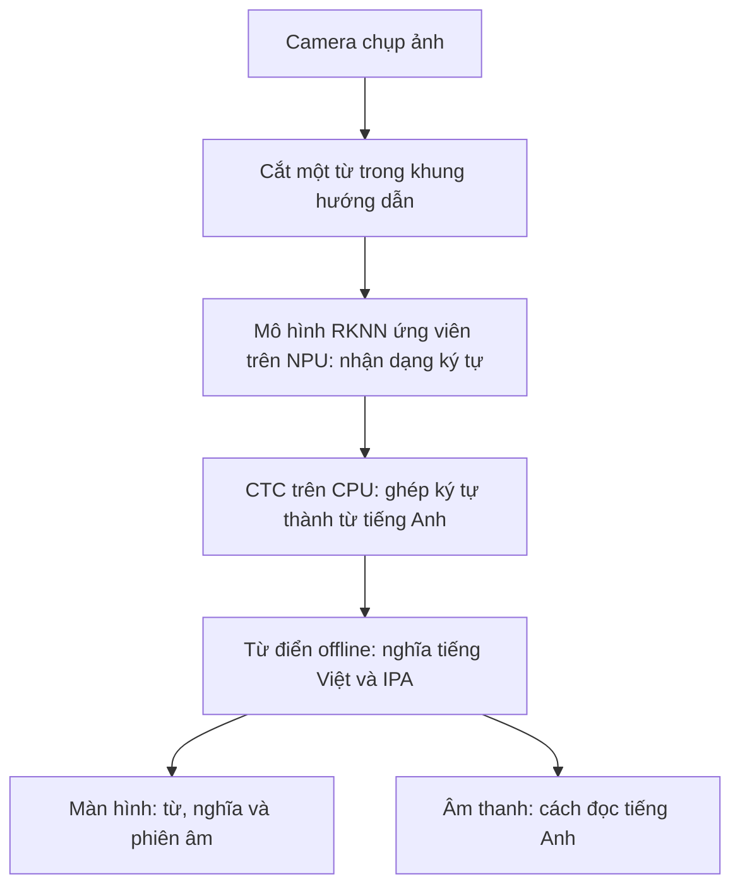

# 🔎 FocusLens

### Hướng tới thiết bị nhìn một từ tiếng Anh → tra nghĩa tiếng Việt, không cần mạng

**Căn từ trong khung · Nhận dạng chữ · Tra nghĩa và IPA · Hiển thị và phát âm**

Hiện có bản tham chiếu Python chạy trên PC và kết quả thử chuyển mô hình sang RKNN.
**Chưa có runtime hoạt động trên Luckfox hoặc số đo phần cứng.**

---

## 💡 Bài toán: tra một từ mà không phụ thuộc điện thoại hay PC

Khi đọc sách tiếng Anh, người học thường phải rời trang giấy để mở điện thoại,
chụp ảnh hoặc gõ từ vào ứng dụng tra cứu. Công cụ cần mạng hay máy tính đi kèm
lại không phù hợp với một thiết bị học tập nhỏ, độc lập.

FocusLens hướng tới thao tác đơn giản: **đưa một từ vào khung, nhấn chụp, thấy
nghĩa tiếng Việt và phiên âm IPA, rồi nghe cách đọc tiếng Anh**. Đây là tra từ,
không phải lấy từ điển ghép thành bản dịch cả câu.

Phần cứng mục tiêu là **Luckfox Pico Max — RV1106G3, RAM tổng 256 MB**.
Thách thức không chỉ là đọc đúng chữ: mô hình, ảnh camera, màn hình và âm thanh
đều phải dùng chung bộ nhớ nhỏ này. Chưa có cam kết về tốc độ hay RAM thực tế.

## 🏗️ Kiến trúc mục tiêu — chưa triển khai trên board

**NPU** là bộ xử lý hỗ trợ chạy mô hình; **CTC** biến chuỗi dự đoán ký tự thành
văn bản, bỏ các vị trí trống và ký tự lặp do mô hình tạo ra.

Trong thiết kế này, PC chỉ chuẩn bị tài nguyên, chuyển đổi mô hình và nạp thiết bị;
**khi sử dụng không cần PC, điện thoại, cloud hay server LAN**.
Từ điển, giao diện và âm thanh nhúng chưa được triển khai; tài nguyên có quyền
phân phối chưa được chọn, camera cụ thể cũng chưa chốt.
Chi tiết nằm trong [kiến trúc offline](docs/OFFLINE_ARCHITECTURE.md).

---

## 📊 Đã có gì: bản tham chiếu và số liệu trên PC

Bản Python hiện có chạy OCR bằng **PP-OCRv5_mobile_det + en_PP-OCRv5_mobile_rec**
trên CPU. Nhánh dịch câu dùng OPUS-MT/CTranslate2 INT8 vẫn được giữ làm tham chiếu
trên PC, **tách biệt với mục tiêu tra một từ**. Nhánh dịch từng ghi nhận RAM đỉnh
**332,1 MiB**, vượt tổng RAM 256 MB của board; kích thước model không phải RAM chạy.

### Nhận dạng trên ảnh từ/dòng đã cắt: v4 → v5

| Tập ảnh | v4 đúng hoàn toàn | v5 đúng hoàn toàn | CER v4 → v5 |
|:---|---:|---:|---:|
| HierText DEV — 200 ảnh | 135/200 | **175/200** | 1,6993% → **0,5152%** |
| IIIT5K TEST — 3.000 ảnh | 2515/3000 | **2541/3000** | 4,1195% → **3,9099%** |
| HierText TEST — 500 ảnh | 274/500 | **424/500** | 2,8283% → **1,3555%** |

**CER** là tỷ lệ lỗi ký tự, càng thấp càng tốt. Bảng này không phân biệt hoa/thường
(casefold), gộp khoảng trắng và giữ dấu câu. v5 tốt hơn tổng thể nhưng vẫn có ảnh
đọc kém hơn v4; không phải cải thiện trên mọi ảnh.

Các tập trên đã được xem trước đây, **không phải đánh giá độc lập trên dữ liệu
chưa từng thấy**. Đây chỉ là nhận dạng ảnh đã cắt, không chứng minh khả năng đọc
từ camera, phát hiện chữ trên trang, dịch hay chạy trên Luckfox.
Nguồn: [baseline recognizer v5](focuslens/benchmarks/RECOGNIZER_V5_BASELINE.md).

### Chuyển sang INT8: tạo được mô hình, nhưng chất lượng giảm

INT8 dùng số có độ chính xác thấp hơn để giảm dung lượng và hướng tới tiết kiệm
tài nguyên. Đổi lại, mô hình có thể đọc sai nhiều hơn. Thử nghiệm dưới đây dùng
**500 ảnh TRAIN để hiệu chỉnh và 500 ảnh TRAIN khác để so sánh**, không trùng ảnh
hay nhóm tiền tố tên tệp giữa hai phần; mẫu được chọn phân tầng.

| Cách chạy | Đúng / 500, phân biệt hoa/thường | CER, phân biệt hoa/thường | Đúng / 500, casefold | CER, casefold |
|:---|---:|---:|---:|---:|
| Paddle, chiều rộng linh hoạt | 263 | 41,4910% | 418 | 3,9533% |
| ONNX, chiều rộng cố định | 264 | 41,5286% | 419 | 3,9533% |
| RKNN INT8, giả lập trên PC | 231 | 44,6913% | 353 | 9,0738% |

Phân biệt hoa/thường là cách chấm chính; casefold chỉ là cách nhìn bổ sung.
Nhãn mẫu chủ yếu viết hoa, không có mẫu chứa dấu câu. TRAIN cũng đã được xem
trước đây: **đây là khảo sát có giới hạn, không phải độ chính xác tổng quát**.

- Chiều rộng cố định không phải nguồn mất chất lượng chính trên mẫu ảnh từ này;
  chưa có kết luận tương tự cho dòng dài.
- So sánh số thực FP32 Paddle–ONNX chỉ đạt ngưỡng nghiêm ngặt ở **490/500 ảnh**,
  dù cả 500 ảnh cho cùng văn bản. Trạng thái nghiêm ngặt vẫn là **FAIL**.
  INT8 được chạy tiếp theo chính sách chẩn đoán riêng, không phải đã đạt nghiệm thu.
- Đã build được RKNN INT8; tệp của thử nghiệm khả thi ban đầu khoảng **3,12 MB**.
  Điều này không chứng minh RAM sử dụng, tốc độ NPU hay khả năng chạy trên board.

Nguồn: [đánh giá 500 + 500 ảnh](docs/RKNN_DATASET_EVALUATION.md) và
[thử nghiệm RKNN + CTC ban đầu](docs/RKNN_CTC_FEASIBILITY.md).

---

## 📌 Kết luận và giới hạn

FocusLens hiện chứng minh được **baseline nhận dạng trên PC** và khả năng tạo
mô hình RKNN thử nghiệm. Kết quả INT8 cho thấy tổn thất chất lượng rõ rệt;
chưa thể coi là bản tối ưu hoàn tất hay sản phẩm nhúng hoạt động.
Thiết bị tra từ độc lập vẫn là **thiết kế mục tiêu**, chưa được xác minh về
camera, màn hình, âm thanh, bộ nhớ hoặc độ trễ trên phần cứng thật.

## 📄 Giấy phép và ghi nhận

Mã tự phát triển dùng giấy phép [MIT](LICENSE). Model, dữ liệu và firmware tham
chiếu giữ giấy phép riêng; các ghi nhận lịch sử được giữ trong
[THIRD_PARTY_NOTICES.md](THIRD_PARTY_NOTICES.md).
